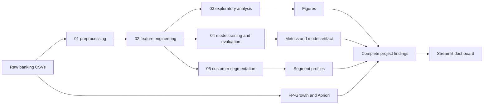

# Customer Behavioral Analysis and Loan Default Classification

## 1. Executive Summary

This project develops an end-to-end data mining and machine learning solution for identifying loan default risk from customer financial behavior. It uses the PKDD'99 Financial Dataset, which contains anonymized Czech bank records from 1993 to 1998.

The project combines transaction-level feature engineering, exploratory analysis, six classification algorithms, hyperparameter tuning, repeated cross-validation, customer segmentation, association-rule mining, and an interactive Streamlit dashboard. The primary business question is:

> Can pre-loan transaction behavior help a bank identify applications that are more likely to default before approving the loan?

The final dataset contains 682 loans: 606 good loans and 76 defaults. The selected headline model is tuned Gradient Boosting trained on the original imbalanced data. It achieves repeated cross-validated F1 of **0.571 +/- 0.120**, Average Precision of **0.654**, and ROC-AUC of **0.864**. Tuned Random Forest is a close alternative, with F1 of 0.556, Average Precision of 0.661, and ROC-AUC of 0.877.

The strongest risk signals are low pre-loan balances, especially `min_balance` and `balance_at_loan`. The results support a balance-capacity review as a useful screening aid, but not an automatic lending decision. The data is historical and contains only 76 defaults, so the model must be revalidated on current portfolio data before production use.

## 2. Problem Statement

Loan defaults create direct financial losses and increase the cost of credit operations. A bank needs an evidence-based way to identify applications that deserve additional review while avoiding unnecessary rejection of reliable customers.

This project treats default prediction as a binary classification problem. Loans with status codes A and C are mapped to `good`; loans with status codes B and D are mapped to `default`. The prediction uses information available before the loan grant date so that the analysis does not use post-loan leakage.

### Objectives

1. Clean and integrate the source banking tables.
2. Build behavioral features from pre-loan transactions.
3. Explore the relationship between behavior and default.
4. Compare six classification algorithms under baseline and SMOTE settings.
5. Select a model using repeated stratified cross-validation rather than one test split.
6. Identify broad customer behavior segments.
7. Discover recurring transaction patterns using Apriori and FP-Growth.
8. Provide an interactive dashboard for comparison, explanation, and pattern review.

## 3. Dataset and Sources

The source is the PKDD'99 Financial Dataset. The repository stores the raw tables in `data/`.

| Table | Role | Description |
|---|---|---|
| `loan.csv` | Target and loan terms | Loan amount, duration, payments, grant date, and status |
| `trans.csv` | Behavioral source | Account transactions, type, amount, balance, and date |
| `client.csv` | Customer attributes | Client identity, birth number, and district |
| `account.csv` | Account metadata | Account creation, district, and statement frequency |
| `disp.csv` | Relationship table | Links clients to accounts and identifies account owners |

The transaction table contains approximately 1.06 million records. The loan table contains 682 loans. The final target distribution is 606 good loans and 76 defaults, giving an 11.14 percent default rate.

## 4. End-to-End Architecture



The notebooks are executed in order:

1. `01_preprocessing.ipynb` cleans the source tables and defines the target.
2. `02_features.ipynb` creates the loan-level modeling table.
3. `03_eda.ipynb` explores distributions, correlations, and risk groups.
4. `04_modeling.ipynb` trains, tunes, evaluates, and saves the best model.
5. `05_segmentation.ipynb` creates behavior-based customer segments.

The supplementary scripts in `tools/` run feature-group analysis and association-rule mining.

## 5. Data Preparation and Feature Engineering

Dates are parsed using the source format `%y%m%d`. The target is created from loan status. Owner relationships are used so each loan is connected to the correct client and account.

For every loan, only transactions strictly earlier than the loan grant date are selected. This prevents information from after the lending decision entering the predictors. The engineered table is saved as `data/loan_features.csv` with 682 rows and 27 columns.

### Behavioral features

The 13 primary behavioral features are:

- Transaction count, deposit count, and withdrawal count.
- Deposit and withdrawal totals.
- Average and standard deviation of transaction amount.
- Average, minimum, and maximum balance.
- Balance on the last transaction before the loan.
- Months of account history.
- Transactions per month.

Loan terms and demographic context are joined afterward. Gender is binary encoded. Continuous modeling features are standardized inside the training pipeline, which prevents scaling information from leaking across folds.

Data-quality checks found no duplicate rows in the source tables, no missing values in the final modeling table, valid dates, and plausible age values. Transaction amount and balance fields are skewed, and several volume variables are strongly correlated. These characteristics are documented and considered when interpreting feature importance.

## 6. Exploratory Data Analysis

The exploratory analysis is implemented in `03_eda.ipynb` and produces the figures in `outputs/figures/`.

### Main findings

- The dataset is imbalanced: 11.14 percent of loans are defaults.
- `min_balance`, `balance_at_loan`, and `avg_balance` have the strongest negative relationships with default.
- The median balance at loan time is approximately 39.5k for good loans and 22.0k for defaults.
- Transaction frequency alone separates the classes weakly; balance capacity is more informative than activity volume.
- Loan amount and payments show a modest positive relationship with default.
- Age and gender show little useful predictive signal and should not be used as decision factors.
- The risk quadrant combining pre-loan balance and loan amount ranges from 4.9 percent default for high-balance, low-amount loans to 23.3 percent for low-balance, high-amount loans.

The analysis also identifies multicollinearity among transaction volume variables. For example, deposit and withdrawal totals are highly correlated. This is why the project interprets related features together rather than treating one importance score as a causal explanation.

## 7. Classification and Evaluation

Six models are compared:

1. Decision Tree
2. Gaussian Naive Bayes
3. Random Forest
4. Calibrated Support Vector Machine
5. K-Nearest Neighbors
6. Gradient Boosting

Each model is evaluated in two settings: the original imbalanced training data and a training-only SMOTE pipeline. The model workflow includes a stratified 75/25 split, randomized hyperparameter search, and repeated stratified 5-fold cross-validation with 10 repeats. Each repeated-CV row therefore contains 50 estimates.

The held-out test metrics are retained as a readable reference, but model selection is based on repeated cross-validation because a single split contains only 19 defaults.

### Repeated-CV selection table

| Model and setting | Tuned F1 | Average Precision | ROC-AUC |
|---|---:|---:|---:|
| Gradient Boosting, baseline | **0.571 +/- 0.120** | 0.654 | 0.864 |
| Decision Tree, baseline | 0.557 +/- 0.126 | 0.507 | 0.748 |
| Random Forest, baseline | 0.556 +/- 0.112 | **0.661** | **0.877** |
| Random Forest, SMOTE | 0.542 +/- 0.103 | 0.638 | 0.872 |
| Gradient Boosting, SMOTE | 0.536 +/- 0.101 | 0.641 | 0.851 |
| SVM, baseline | 0.498 +/- 0.128 | 0.603 | 0.842 |
| Decision Tree, SMOTE | 0.464 +/- 0.104 | 0.307 | 0.741 |
| SVM, SMOTE | 0.463 +/- 0.084 | 0.608 | 0.848 |
| KNN, SMOTE | 0.367 +/- 0.065 | 0.367 | 0.768 |
| Naive Bayes, baseline | 0.325 +/- 0.132 | 0.356 | 0.769 |
| Naive Bayes, SMOTE | 0.318 +/- 0.055 | 0.338 | 0.729 |
| KNN, baseline | 0.223 +/- 0.129 | 0.249 | 0.628 |

### Model selection interpretation

Tuned Gradient Boosting is the headline model because it has the highest repeated-CV F1 under the stated selection rule. Random Forest belongs to the same leading group: its F1 is within the observed fold-to-fold variation and it leads on Average Precision and ROC-AUC. Therefore, Gradient Boosting is a defensible classification choice, while Random Forest may be preferred when the bank primarily wants a high-quality ranking of applications.

SMOTE improves KNN but reduces tuned F1 for the other five models. This indicates that resampling should not be adopted automatically. Hyperparameter tuning has its largest positive effect on SVM and Decision Tree, while the two ensemble models are relatively stable.

The persisted headline pipeline is stored at `outputs/models/best_GradientBoosting_baseline_tuned.pkl`.

## 8. Feature and Risk Interpretation

Random Forest feature importance and correlation analysis identify low balances as the most consistent risk signal. The most important variables include:

- `min_balance`
- `balance_at_loan`
- `txn_per_month`
- `payments`
- `amount`
- `avg_balance`

These results do not establish that low balance causes default. They indicate that low demonstrated liquidity is useful for prioritizing review. Age and gender contribute little signal and should remain descriptive context rather than lending decision variables.

## 9. Customer Segmentation

The segmentation notebook applies KMeans to the 13 behavioral features without using the target during clustering. A two-segment solution is selected using the silhouette assessment.

| Segment | Behavioral profile | Size | Default rate |
|---|---|---:|---:|
| 0 | Quieter activity and lower average balance | 421 | 12.4% |
| 1 | More active accounts and higher average balance | 261 | 9.2% |

The segments overlap and the silhouette score is modest, so these groups describe broad tendencies rather than sharply separated customer types. The quieter, thinner-balance segment has the higher default rate and can guide review prioritization.

## 10. Pattern Recognition with Apriori and FP-Growth

The supplementary pattern-mining layer treats each account's pre-loan activity as a basket. Basket items include transaction types, high-amount activity, and negative-balance behavior. The implementation is in `tools/pattern_mining.py`.

Both methods run with a minimum support of 0.05 and maximum itemset length of three. The generated outputs are:

- `outputs/pattern_itemsets.csv`: 25 Apriori itemsets and 25 FP-Growth itemsets.
- `outputs/pattern_rules.csv`: default-oriented association rules.

At the current support and confidence thresholds, the generated run produces zero rules whose consequent is default. This is a valid result: the frequent behavioral combinations do not meet the configured confidence threshold for a default consequence. It should not be presented as evidence that no risky patterns exist. Threshold sensitivity or a larger/current dataset would be needed for more rule discovery.

Apriori is useful as an explainable baseline that enumerates candidate itemsets. FP-Growth is more efficient when the basket collection is larger or contains dense repeated combinations. Neither method replaces the predictive classifier; it provides an interpretable pattern-discovery layer alongside classification.

## 11. Streamlit Dashboard

The dashboard is implemented in `app.py` using Streamlit and reads the persisted CSV and figure artifacts rather than retraining models on every page load. It contains three sidebar views:

### Model comparison

Displays the model leaderboard, F1 versus ROC-AUC chart, all cross-validation configurations, held-out reference metrics, and segment summaries.

### Why the best model

Explains the Gradient Boosting selection using repeated-CV metrics, compares it with Random Forest, shows the reference feature-importance figure, and separates the selection evidence from the single-split reference table.

### FP-Growth and patterns

Displays frequent itemsets and default-oriented rules when the generated output files exist. If the files are absent, the page provides the command required to generate them instead of failing silently.

The dashboard can be opened locally at `http://localhost:8501` after starting Streamlit.

## 12. Repository Structure and Deliverables

- `data/`: raw and engineered data files.
- `docs/`: reports, requirements, references, and project documentation.
- `notebooks/`: executed analysis pipeline from preprocessing through segmentation.
- `outputs/`: metrics, figures, model artifact, segment profiles, and pattern tables.
- `tools/`: feature-group and association-rule scripts.
- `sql/`: Snowflake setup script for the analytical warehouse layer.
- `app.py`: Streamlit dashboard entry point.
- `requirements.txt`: pinned Python dependencies.

Important generated deliverables include `loan_features.csv`, `metrics_comparison.csv`, `cv_comparison.csv`, `tuning_results.csv`, `segment_profiles.csv`, `pattern_itemsets.csv`, `pattern_rules.csv`, the saved best-model pipeline, and the figures under `outputs/figures/`.

## 13. Reproducibility

From the repository root, install the requirements and execute the notebooks in order:

```bash
pip install -r requirements.txt
python -m nbconvert --to notebook --execute notebooks/01_preprocessing.ipynb --output 01_preprocessing.ipynb
python -m nbconvert --to notebook --execute notebooks/02_features.ipynb --output 02_features.ipynb
python -m nbconvert --to notebook --execute notebooks/03_eda.ipynb --output 03_eda.ipynb
python -m nbconvert --to notebook --execute notebooks/04_modeling.ipynb --output 04_modeling.ipynb
python -m nbconvert --to notebook --execute notebooks/05_segmentation.ipynb --output 05_segmentation.ipynb
python tools/feature_group_analysis.py
python tools/pattern_mining.py
python -m streamlit run app.py
```

The dashboard reads existing outputs, so it can be launched after the artifacts are available. A clean notebook run with no assertion or execution errors is the reproducibility pass condition.

## 14. Limitations and Responsible Use

1. The source records end in 1998 and may not represent current banking behavior.
2. Only 76 defaults are available, so performance estimates have substantial uncertainty.
3. The tuned cross-validation scores are mildly optimistic because hyperparameters were searched on the training split before repeated evaluation; nested cross-validation would reduce this bias.
4. A small F1 difference between leading models should not be treated as proof that one model is universally superior.
5. Association rules depend strongly on item definitions, support, and confidence thresholds.
6. Correlation and feature importance describe predictive association, not causation.
7. The model should support human review and monitoring, not make an unsupervised lending decision.

Before deployment, the bank should retrain and validate on recent data, monitor drift and subgroup performance, review threshold and cost choices, and document human oversight.

## 15. Conclusion

The project demonstrates a complete data mining workflow from raw financial transactions to a usable analytical interface. The strongest evidence is consistent across several stages: low pre-loan balances are associated with higher default risk, a baseline ensemble is more reliable than automatic SMOTE balancing, and repeated cross-validation provides a more defensible selection basis than one held-out split.

Tuned Gradient Boosting is selected as the headline model, with Random Forest as a credible ranking alternative. Segmentation adds a portfolio view, while Apriori and FP-Growth provide a supplementary pattern-recognition layer. The Streamlit dashboard makes these results accessible for review, and the documented limitations define the work required before operational deployment.